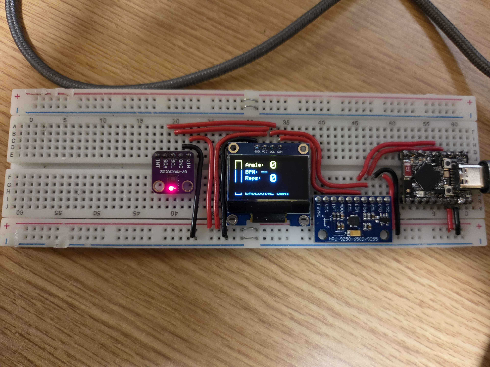
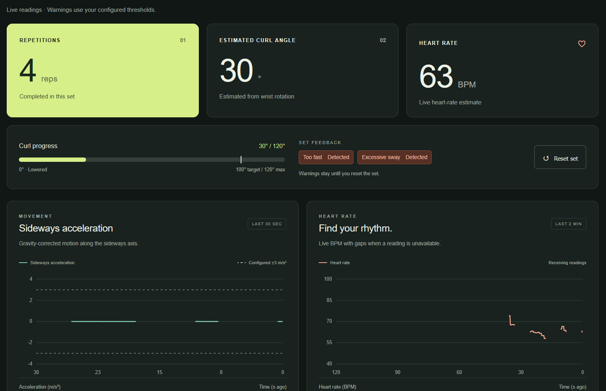

# Exercise Monitor

An ESP32-S3-based exercise monitoring system that tracks movement, estimates heart rate, counts repetitions, and provides real-time feedback through an OLED display and a locally hosted web dashboard.

**Status:** WIP

## Project Overview

The Exercise Monitor is an exercise-tracking prototype intended for wrist-mounted monitoring of movement during biceps curls (may add more exercises in the future).

Using an accelerometer, gyroscope, and optical heart-rate sensor, the system tracks arm movement, estimates curl angles, counts completed repetitions, and identifies excessive movement speed and sideways sway.

Sensor readings are displayed on an onboard OLED and transmitted wirelessly to a locally hosted web dashboard.

## Hardware Prototype



*Current breadboard prototype. WIP.*

## Web Dashboard



## Features

- **Motion Tracking:** Uses the MPU6500 accelerometer and gyroscope to estimate orientation and track curl angles.
- **Repetition Counting:** Detects completed repetitions based on movement through defined angular thresholds.
- **Exercise Feedback:** Detects excessive curl speed and sideways movement, displaying warnings through the OLED and onboard LED.
- **Heart Rate Monitoring:** Uses the MAX30102 optical sensor to detect heartbeats and estimate BPM.
- **OLED Display:** Displays curl angle, repetition count, heart rate, and exercise warnings.
- **Live Web Dashboard:** Displays sensor readings, movement history, heart-rate history, and set progress.
- **Wireless Communication:** Hosts a local Wi-Fi network and uses WebSockets to transmit live readings and receive reset commands.
- **Touch Reset:** Uses the ESP32-S3 capacitive-touch functionality to reset the current exercise set. A physical reset button is planned for a future hardware revision.

## Hardware Components

| Component | Purpose |
|---|---|
| ESP32-S3 Mini | Main microcontroller |
| MPU6500 | Accelerometer and gyroscope |
| MAX30102 | Optical heart-rate sensor |
| SSD1306 OLED | On-device display |
| Breadboard and jumper wires | Prototyping and connections |

## System Architecture

The ESP32-S3 acts as the central controller, collecting sensor readings, processing movement data, and updating the output devices.

- The MPU6500, MAX30102, and OLED communicate with the microcontroller through I2C.
- The accelerometer and gyroscope measurements are combined to estimate orientation while compensating for gravity.
- The MAX30102 provides optical readings used for heartbeat detection and BPM estimation.
- The OLED and NeoPixel provide immediate feedback.
- The ESP32-S3 hosts a local web server and WebSocket endpoint for the browser dashboard.

## Software Architecture

The firmware is divided into separate modules to keep sensor processing, display logic, and networking independent.

| File | Responsibility |
|---|---|
| `main.cpp` | Main program execution and timing |
| `MPU6500.cpp` | Motion sensing and orientation estimation |
| `MAX30102.cpp` | Heart-rate sampling and BPM estimation |
| `OLED.cpp` | OLED initialization and display updates |
| `NeoPixel.cpp` | LED feedback |
| `WebDashboard.cpp` | Wi-Fi hosting and WebSocket communication |
| `utils.cpp` | Serial output, warnings, and touch reset logic |

The web dashboard is maintained separately from the firmware:

- `index.html` – Dashboard structure
- `style.css` – Dashboard styling and responsive layout
- `script.js` – WebSocket communication, live updates, and chart rendering

## Technologies

- **Firmware:** C++, Arduino framework
- **Microcontroller:** ESP32-S3
- **Development Environment:** PlatformIO, VS Code
- **Communication:** I2C, Wi-Fi, WebSockets
- **Frontend:** HTML, CSS, JavaScript
- **Filesystem:** LittleFS

## Getting Started

### Requirements

- VS Code with the PlatformIO extension
- ESP32-S3 Mini development board
- Required sensors and display
- USB connection to the microcontroller

### Installation

1. Clone the repository:

   ```bash
   git clone https://github.com/Goosenator123/exercise-monitor.git
   ```

2. Open the project folder in VS Code.

3. Allow PlatformIO to install the dependencies specified in `platformio.ini`.

4. Connect the ESP32-S3 and select the appropriate upload port.

5. Build and upload the firmware using PlatformIO.

6. Upload the dashboard files to the ESP32-S3 LittleFS filesystem using **Upload Filesystem Image**.

7. Keep the motion sensor flat and stationary during startup calibration

8. Connect your computer or phone to the ESP32-S3 Wi-Fi network.

9. Open the dashboard using the device's local IP address (http://192.168.4.1).

*This project was done purely out of personal interest. Heart-rate readings and movement estimates are experimental and are not intended for medical use.*
